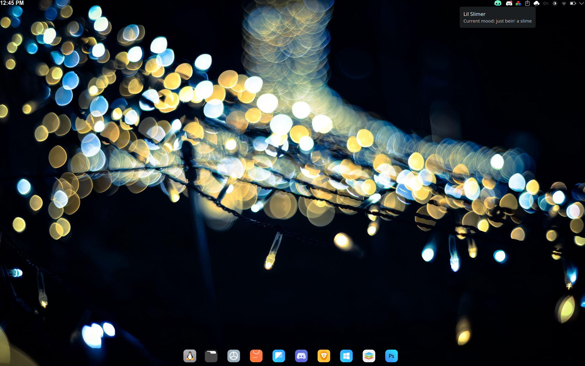

<p align="center">
  
</p>

<p align="center">
  <strong>A tiny, reactive desktop slime companion for KDE Plasma 6</strong><br>
  No accounts, grinding, or notifications. Just slime 🧪
</p>

<p align="center">
  <a href="#meet-lil-slimer">Meet Slimer</a> ·
  <a href="#moods--animations">Moods</a> ·
  <a href="#installation">Installation</a> ·
  <a href="#how-it-works">How it works</a>
</p>

---

## Meet Lil Slimer

Lil Slimer is a tiny digital companion who lives in your KDE Plasma panel (or on your desktop, if that's your thing). He quietly reacts to CPU activity, battery levels, charging, terminal usage, idle time, and KDE Discover update indicators.

He's not a productivity dashboard or a virtual pet demanding constant attention. He just hangs out, looks around, gets sleepy, judges your terminal commands, and occasionally starts cooking when you push your computer too hard.

Hover over him to see a randomized description of his current mood. Sometimes he's *dead to the world*. Sometimes he's *locked in*. Sometimes he's just bein' a slime.

## Desktop Screenshot

<p align="center">
  
</p>

## Why?

I wanted a persistent digital pet on my Fedora KDE desktop, but everything I found was either way too much or way too little. Some were overloaded with menus, mechanics, currencies, and constant interaction. Others barely reacted at all, were on the same boring loop, or just sat there like dead decorations.

So I created a little slime creature like Frankenstein's monster.

## Moods & Animations

Slimer's moods are driven by your computer's activity. These GIFs are small previews of his actual sprite animations; some live transitions and randomized timing will vary.

### Everyday Slime

| Mood | Preview | What's happening |
|:--|:--:|:--|
| **Active** |  | Normal activity. Just vibing, looking around, and living the slime life. |
| **Calm** |  | Things have been quiet for a while. Time to relax. |
| **Drowsy** |  | Continued inactivity. He's fighting to stay awake. |
| **Sleeping** |  | The system has been idle long enough for a proper slime nap. |

### Battery Drama

| Mood | Preview | What's happening |
|:--|:--:|:--|
| **Charging** |  | Plugged in and soaking up electricity. |
| **Drained** |  | Low battery (11-20%). He's upset! |
| **Dead** |  | Critical battery (10% or below). Tell his family he slimed. |

### Working Hard (or Ready to Die)

| Mood | Preview | What's happening |
|:--|:--:|:--|
| **Productive** |  | Sustained workload. Shades on. Slime grindset activated. |
| **Hell** |  | Heavy sustained workload. Compiling, stress testing, or absolutely bodying the system. |
| **Judging** |  | Terminal detected. He's watching your commands, and he's not impressed. Note: He doesn't *always* judge, but when he does... boy does he.|

### Update Anxiety

| Mood | Preview | What's happening |
|:--|:--:|:--|
| **Unamused** |  | KDE Discover's update tray icon appears. Slimer wonders if the next update will cause a kernel panic, then goes about his business.|

On an idle machine, his everyday progression is roughly:

```text
active → calm → drowsy → sleeping
```

Battery and workload conditions, plus the special terminal-judging behavior, can change what he does. The GIFs are representative loops; Slimer's actual behavior is controlled by the live QML frontend and Python brain.

## Features

- Native **KDE Plasma 6** widget for panels and desktops
- Original pixel-art sprites with animated, reactive moods
- CPU monitoring with rolling workload averages
- Idle, drowsy, and sleeping behavior
- Battery-level and charging reactions
- Productive and compile-hell modes
- Terminal-triggered Judge mode
- Discover update tray detection
- Randomized tooltip mood descriptions
- Lightweight **Python 3** backend managed by **systemd --user**
- Panel and desktop scaling
- Installer and uninstaller included

## Installation

### Requirements

- KDE Plasma 6
- Python 3
- `busctl` (systemd D-Bus utility, used to detect Discover's tray icon)
- `systemd --user`
- `kpackagetool6`
- `kdotool` recommended for terminal/window detection; `xdotool` fallback supported

Clone the repository and run the installer **as your regular desktop user, not with `sudo`**:

```bash
git clone https://github.com/vrgb-dev/lilslimer.git
cd lilslimer
chmod +x install.sh uninstall.sh
./install.sh
```

Then add him to your panel or desktop:

```text
Right-click panel or desktop → Add Widgets → Lil Slimer
```

The installer registers the Plasma widget, installs the backend, enables the user service, and restarts Plasma. Running it again upgrades an existing installation.

### Useful commands

```bash
systemctl --user status lilslimer-brain.service
systemctl --user restart lilslimer-brain.service
journalctl --user -u lilslimer-brain.service -f
```

## Uninstall

From the repository directory:

```bash
./uninstall.sh
```

The uninstaller stops and removes the user service, backend, and installed widget package. It does **not** delete your source checkout.

**KDE panel note:** If Lil Slimer was still attached to a panel, Plasma may retain an invisible or **Unknown** widget instance after uninstalling. Remove the orphaned widget manually in panel Edit Mode. This is a saved panel-layout reference, not a running Slimer backend.

## How It Works

Lil Slimer is split into two small pieces:

| Component | Responsibility |
|:--|:--|
| **QML frontend** | Draws sprites, runs animations and transitions, scales the widget, and displays randomized mood tooltips. |
| **Python backend** | Reads CPU, battery, idle, terminal, and Discover tray status; evaluates state priority; writes the current state as JSON. |

The Python brain runs as a systemd user service. The plasmoid reads its state from:

```text
~/.local/share/plasma/plasmoids/org.vrgb.lilslimer/contents/ui/state.json
```

No cloud service, account, or external API is required. Discover integration uses the local KDE StatusNotifierWatcher D-Bus interface; Slimer does not check for updates itself or issue notifications. The Unamused reaction fires once when Discover's tray item becomes active (including at startup), lasts 30 seconds, and does not repeat while the item stays active. Discover integration is best-effort and depends on the notifier exposing its StatusNotifierItem.

## Philosophy

Lil Slimer is intentionally small in scope. He is **not**:

- An AI assistant
- A productivity dashboard
- A Tamagotchi grind simulator
- A notification machine
- A giant desktop overlay

The goal is a tiny companion that feels ambient, reactive, funny, and alive without becoming distracting or exhausting.

## Project Status

**v0.6.1 — public release.** Core functionality has been running on multiple KDE Plasma machines. The current installer, in-place upgrade, and uninstaller have been tested on Fedora KDE; broader distribution compatibility is not yet guaranteed.

### Ideas for Later

- Optional dropdown information panel
- Additional ambient behaviors and contextual moods
- KDE Store packaging
- AUR / COPR packaging
- GNOME support
- Cinnamon support
- Additional slime variants
- Optional Rated-R Slimer

The plan is to add personality without turning the project into bloated junk.

## License

Lil Slimer is released under the [MIT License](LICENSE).


### Part of the VRGB family

Lil Slimer is an independent open-source project from **[vrgb-dev](https://github.com/vrgb-dev)**, the developer behind **[VRGB](https://github.com/vrgb-dev/vrgb)** — an open-source RGB keyboard lighting utility for ASUS laptops running Linux.

Different projects, same philosophy: lightweight Linux software with a little personality.

It's Slime Time™ 🧪
